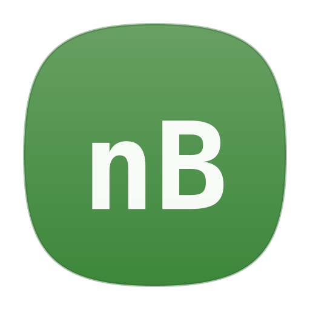

<p align="center">
  
</p>

<h1 align="center">nodeBar</h1>

<p align="center">
  A lightweight macOS menu bar app to manage your Node.js dev servers
</p>

<p align="center">
  
  
  <a href="LICENSE"></a>
  <a href="https://github.com/AKSharma/nodeBar/stargazers"></a>
</p>

<!-- TODO: Add screenshot here -->

## Features

- **Start / Stop / Restart** Node.js apps from the menu bar
- **Automatic port detection** via output regex and `lsof` polling
- **One-click "Open in Browser"** for detected ports
- **Real-time log output** with error highlighting
- **Auto-start apps on launch** (per-app toggle)
- **Launch at login**
- **Custom start commands** — npm, yarn, pnpm, bun, or anything else
- **Custom environment variables** per app
- **No Dock icon** — stays out of your way
- **Graceful shutdown** with full process tree cleanup

## Installation

### Download DMG

Grab the latest `.dmg` from the [GitHub Releases](https://github.com/AKSharma/nodeBar/releases) page.

> **Note:** nodeBar is not signed with an Apple Developer certificate. On first launch, right-click the app → **Open** → click **Open** in the dialog to bypass Gatekeeper.

### Build from Source

```bash
git clone https://github.com/AKSharma/nodeBar.git
cd nodeBar

# Build a DMG (recommended)
./scripts/build-dmg.sh

# Or build with Swift directly
swift build -c release
```

The DMG will be placed in `build/nodeBar.dmg`.

## Getting Started

1. Click the **nodeBar icon** in your menu bar
2. Click **Add App** and choose a project directory
3. Set the start command (e.g. `npm run dev`)
4. Click **Start**

Port detection is automatic — when your app prints a port or starts listening, nodeBar picks it up. Click the port number to open it in your browser.

## Configuration

nodeBar stores its config at:

```
~/.nodebar/config.json
```

Available settings include:

| Setting | Description |
|---------|-------------|
| Launch at Login | Start nodeBar when you log in |
| Auto-start | Automatically start selected apps when nodeBar launches |
| Max Log Lines | Number of log lines to keep per app |

You can edit these from the **Settings** view inside the app.

## Requirements

- **macOS 14.0** (Sonoma) or later
- Apple Silicon or Intel Mac

## Project Structure

```
Sources/
├── App/
│   └── NodeBarApp.swift          # Entry point
├── Models/
│   ├── AppStatus.swift
│   ├── LogEntry.swift
│   └── NodeApp.swift
├── Resources/
│   ├── AppIcon.icns
│   └── Info.plist
├── Services/
│   ├── ConfigurationService.swift
│   ├── PortDetectionService.swift
│   └── ProcessService.swift
├── Utilities/
│   └── Constants.swift
├── ViewModels/
│   └── AppManager.swift
└── Views/
    ├── AddAppView.swift
    ├── AppDetailView.swift
    ├── AppListView.swift
    ├── AppRowView.swift
    ├── EmptyStateView.swift
    ├── LogView.swift
    ├── MenuBarContentView.swift
    └── SettingsView.swift
```

## Contributing

Contributions are welcome! Here's how:

1. **Fork** the repo
2. **Create a branch** (`git checkout -b my-feature`)
3. **Commit** your changes (`git commit -m 'Add my feature'`)
4. **Push** to the branch (`git push origin my-feature`)
5. **Open a Pull Request**

Feel free to open an issue for bugs or feature requests.

> nodeBar has **zero external dependencies** — it's pure Swift and SwiftUI, so getting started is straightforward.

## License

This project is licensed under the **GNU General Public License v3.0** — see the [LICENSE](LICENSE) file for details.

---

<p align="center">Made with ♥ for the Node.js community</p>
